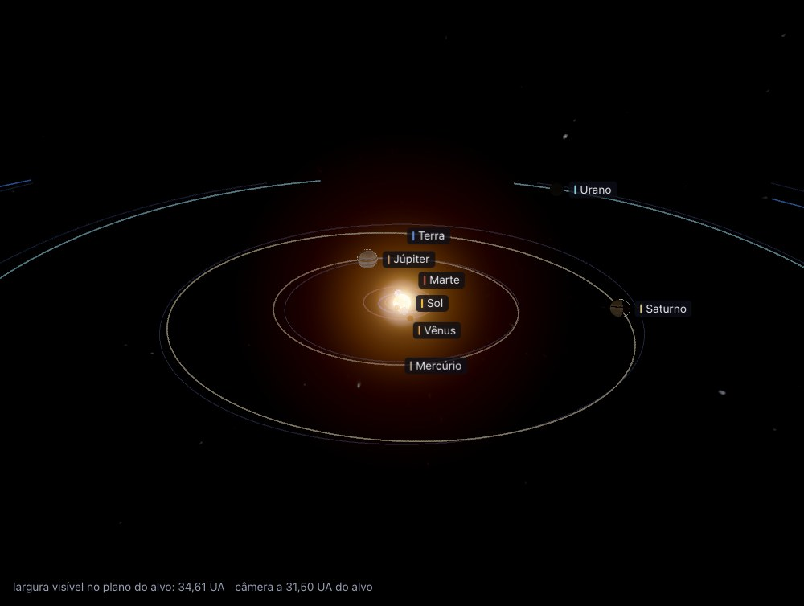
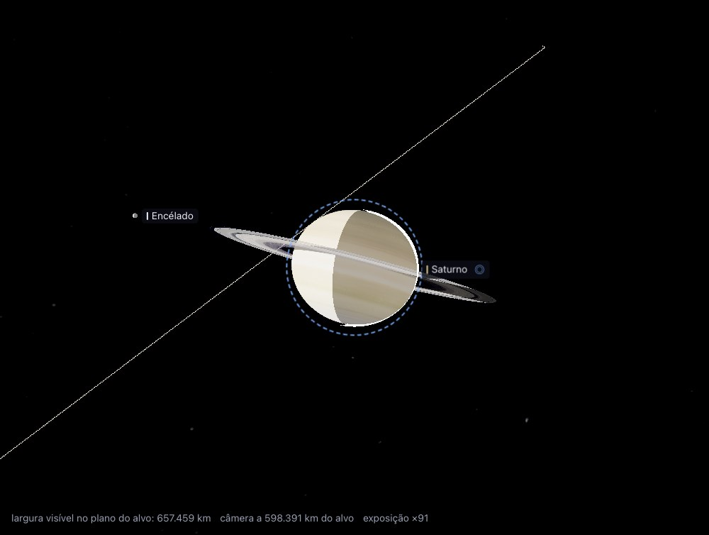
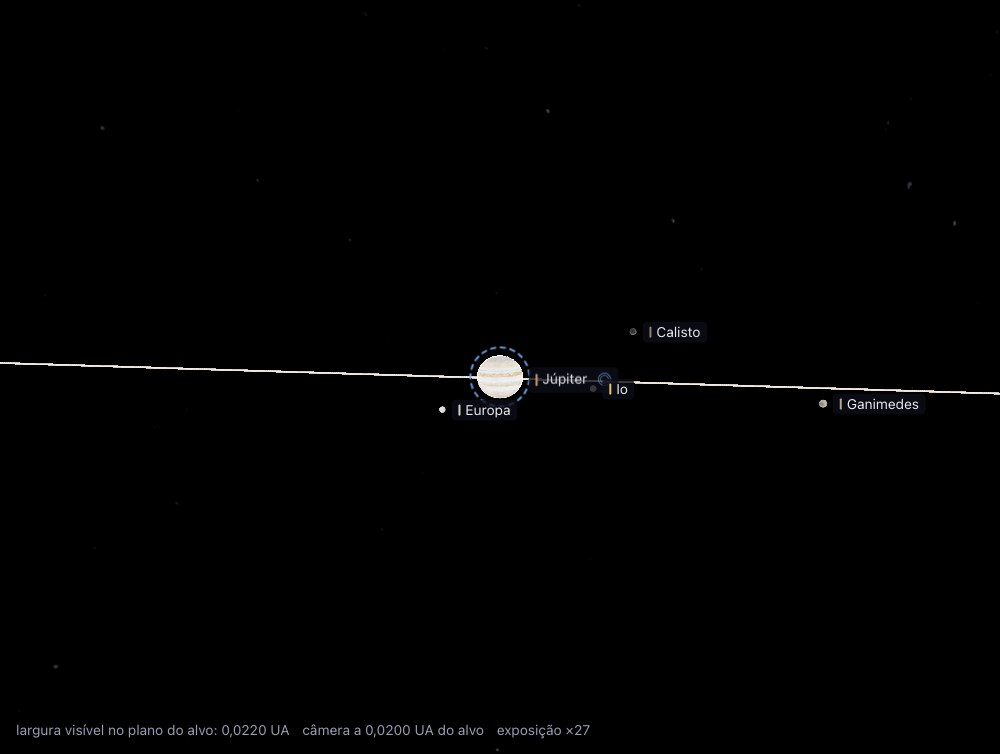

# Solar System 3D

[Português](README.pt-BR.md)

A solar system simulator that runs in the browser, built for a university course (Computer Science, IDP). It integrates the nine bodies of the JPL ephemeris with a fourth-order symplectic N-body integrator (Yoshida, half-day step), draws the thirteen moons, and carries the educational layer in Portuguese: body sheets, activities, a Fourier laboratory that rewrites an orbit as a chain of epicycles, and a mode for creating new bodies.

The project started from a question in an undergraduate thesis (see Credits): can a sum of rotating circles describe the orbit of a planet? The accompanying paper, in Portuguese, answers it with numbers, and the simulator is what the paper describes.







## Try it online

[](https://github.com/Felps-26/do-epiciclo-a-elipse/actions/workflows/ci.yml)

Live version: https://felps-26.github.io/do-epiciclo-a-elipse/

The online version ships only the 2K textures, so surfaces look softer in close-ups than in the delivery folder, which also has 4K.

## Running it locally

You need Node 20.19 or newer ([nodejs.org](https://nodejs.org)). Inside `simulador/`:

| System | How |
|---|---|
| Windows | double-click `run.bat`, or `./run.ps1` in PowerShell |
| macOS | double-click `run.command` (if macOS blocks it, right-click and choose Open) |
| Linux | `./run.sh` |

The first run installs the libraries and builds the program, which takes a minute or two. The delivery zip already includes the built `dist/`, so there only a local server starts. Without Node, `run.bat` falls back to a small Python server (`ferramentas/servidor.py`) when `dist/` is present. The server listens on 127.0.0.1 only, and closing the browser tab shuts it down.

The program does not touch the network while in use. Only the scripts in `simulador/ferramentas/` do, and only when someone runs them to regenerate data.

## Running the tests

From `simulador/`:

```bash
npm ci
npm test
```

`npm test` runs type checking, lint, the architecture rules (`dependency-cruiser`), unit tests and the Playwright end-to-end tests, in that order. Each step can be run on its own: `npm run tipos`, `lint`, `arquitetura`, `unidade`, `e2e`. The unit suite includes the validation of the integrator against the JPL DE440s over ±100 years. The same steps run on every push in `.github/workflows/ci.yml`, on Ubuntu and Windows.

## Reproducing the experiments

The tables and plots of the paper come from Python scripts in `artigo/experimentos/`, which reimplement the physics core independently and read the same initial conditions as the simulator.

```bash
pip install numpy scipy matplotlib jplephem
cd artigo/experimentos
python e1_validacao.py
python e2_integradores.py
python e4_copernico.py
python e5_ptolomeu.py
```

Experiments 6 and 7 compare against the DE440s ephemeris, which is not in the repository (32 MB). Download `de440s.bsp` from the [NAIF archive](https://naif.jpl.nasa.gov/pub/naif/generic_kernels/spk/planets/de440s.bsp) into `artigo/experimentos/`. `artigo/experimentos/LEIAME.md` lists every script, the order to run them and how long each takes.

To compile the paper, run `artigo/compilar.bat` with MiKTeX or TeX Live (pdfLaTeX and BibTeX). The delivery zip carries the compiled PDF as `artigo.pdf` at its root.

## Repository layout

| Folder | Contents |
|---|---|
| `simulador/` | the TypeScript and three.js simulator, its tests and launchers |
| `artigo/` | the paper (LaTeX, ABNT), experiment scripts and figures |
| `versoes-anteriores/` | v1 (Fourier series, Python) and v2 (N-body, Python and pygame), kept as history |

## Known defects

A visual sweep of the simulator on 6 November 2026 listed 40 findings. At the time of the sweep, 15 were fixed and 25 were still open: 1 seen on screen, 21 found by reading code but not observed on screen, and 3 not tested. The full list, with severity and visible effect, is in `simulador/ACHADOS-VISUAIS.md`. That list can lag behind `simulador/CONTRATO.md`, which records as fixed several items the list still shows as open.

The online version has only the 2K textures. When the camera gets close to a body, the program asks for the 4K and 8K files, which are not there, and the surface stays at 2K.

## Future work

- Compress the textures to KTX2, to shrink the delivery and the video memory use.
- Split `principal.ts` into smaller modules.
- Merge the duplicated colour definitions of `base.css` and `tema.ts` into a single source.
- Add a pass for SDR displays on top of the current rendering.

## Credits

- Authors: Filipi Ramos and Thiago Vinícius.
- Supervisor: Prof. Alexandre, Computer Science, IDP.
- The idea comes from the undergraduate thesis *Copérnico estava certo? Uma análise de epiciclos e séries de Fourier* by Maria Licia de Lima Farias (2016), supervised by Prof. Dr. Paulo Eduardo de Brito.
- Positions, velocities and body data come from the JPL Horizons service and the DE440/DE441 ephemerides (Jet Propulsion Laboratory, NASA). The star field uses the Yale Bright Star Catalogue.
- Textures for the planets, the Moon, the Sun and the Milky Way panorama are from [Solar System Scope](https://www.solarsystemscope.com/textures/), under CC BY 4.0. The maps of Io, Europa, Ganymede, Callisto and Enceladus are mosaics from the [USGS Astrogeology Science Center](https://astrogeology.usgs.gov/), a US government product in the public domain. The provenance of each map is recorded in `simulador/ferramentas/baixar_texturas.mjs`.
- Parts of the programming, code review and writing used Claude, an AI assistant from Anthropic, as a development tool. Design decisions, checking of results and responsibility for the content are the authors'.

## Licenses

- Code: MIT, see `LICENSE`.
- Paper in `artigo/`: CC BY 4.0, see `artigo/LICENSE`.
- Textures keep the licenses of their sources, listed above.
