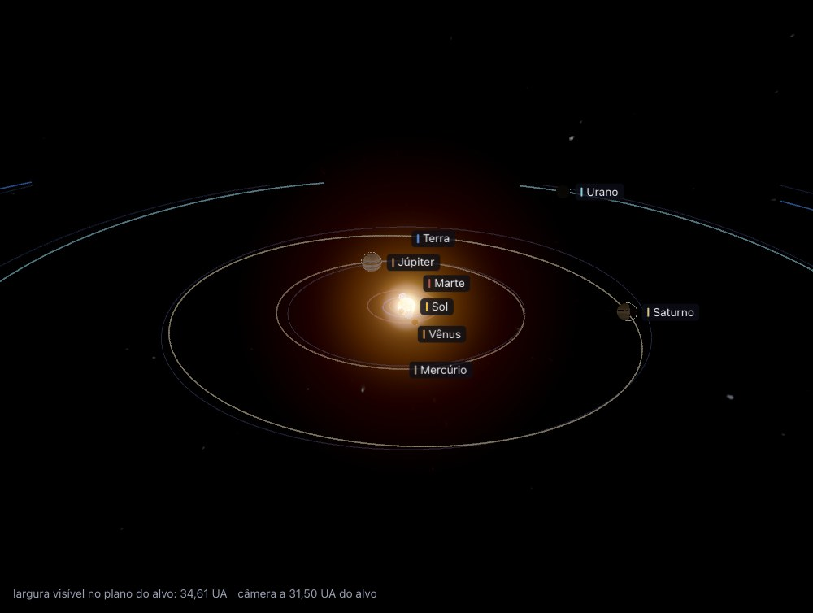
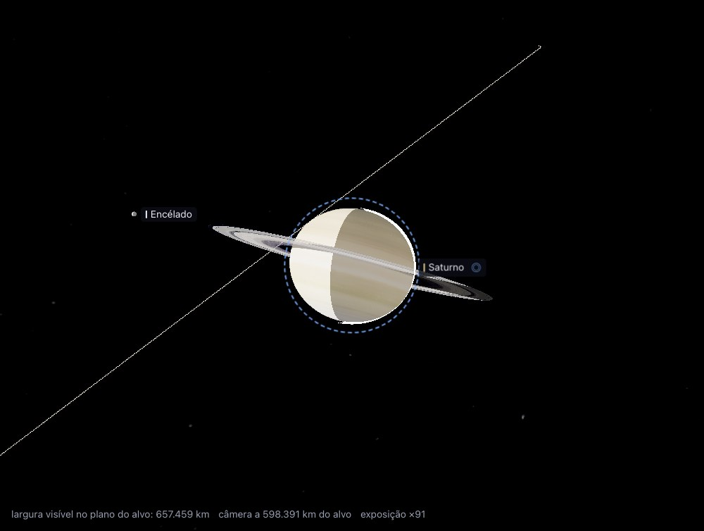
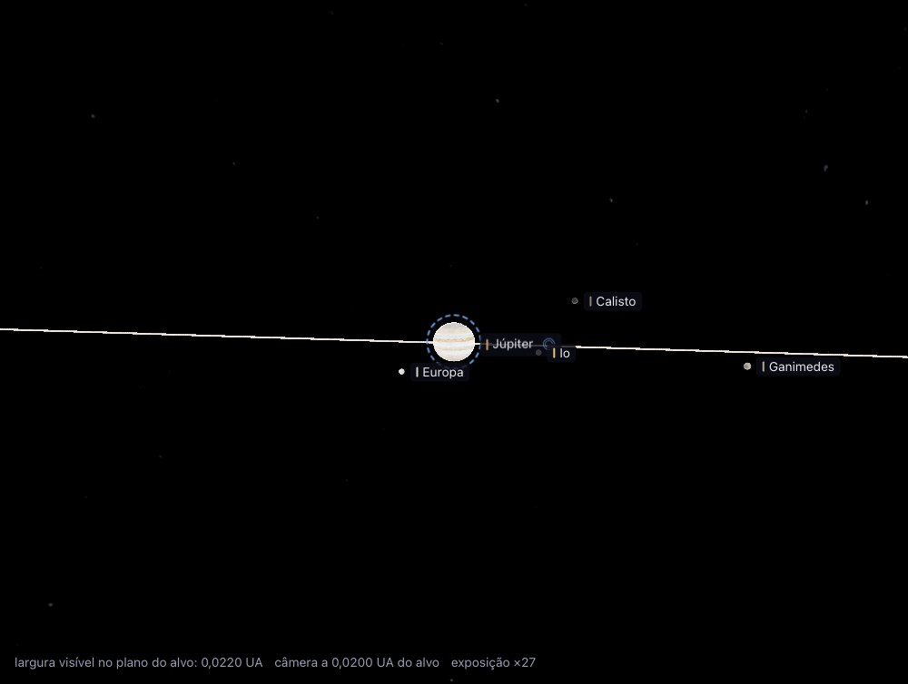

# Sistema Solar 3D

[English](README.md)

Simulador do Sistema Solar que roda no navegador, feito para uma disciplina da graduação (Ciência da Computação, IDP). Ele integra os nove corpos da efeméride do JPL por N-corpos simplético de quarta ordem (Yoshida, passo de meio dia), desenha as treze luas e traz a camada educativa em português: fichas dos corpos, atividades, um laboratório de Fourier que reescreve uma órbita como cadeia de epiciclos e um modo de criação de corpos.

O projeto partiu de uma pergunta de um trabalho de conclusão de curso (veja os créditos): uma soma de círculos girando consegue descrever a órbita de um planeta? O artigo que acompanha o simulador responde com números, e o simulador é o que o artigo descreve.







## Versão online

[](https://github.com/Felps-26/do-epiciclo-a-elipse/actions/workflows/ci.yml)

Versão no ar: https://felps-26.github.io/do-epiciclo-a-elipse/

A versão online leva só as texturas 2K, então as superfícies ficam mais suaves nas aproximações. O repositório também não traz os arquivos 4K e 8K.

## Como abrir

É preciso ter o Node 20.19 ou mais novo ([nodejs.org](https://nodejs.org)). Dentro de `simulador/`:

| Sistema | Como |
|---|---|
| Windows | duplo clique em `run.bat`, ou `./run.ps1` no PowerShell |
| macOS | duplo clique em `run.command` (se o macOS bloquear, botão direito e Abrir) |
| Linux | `./run.sh` |

Na primeira execução o lançador instala as bibliotecas e constrói o programa, o que leva um ou dois minutos. O `dist/` não está no repositório, então a construção sempre roda na primeira execução. Sem o Node, o `run.bat` usa um servidor pequeno em Python (`ferramentas/servidor.py`), mas só se o `dist/` já existir, por exemplo se alguém o construiu em outra máquina. O servidor escuta só em 127.0.0.1, e fechar a aba do navegador o encerra.

O programa não acessa a rede durante o uso. Só os scripts de `simulador/ferramentas/` acessam, e só quando alguém os roda para regerar dados.

## Como rodar os testes

Em `simulador/`:

```bash
npm ci
npm test
```

O `npm test` roda, nesta ordem, tipos, lint, regras de arquitetura (`dependency-cruiser`), testes de unidade e testes ponta a ponta com Playwright. Cada etapa roda sozinha: `npm run tipos`, `lint`, `arquitetura`, `unidade`, `e2e`. A suíte de unidade inclui a validação do integrador contra a DE440s do JPL em ±100 anos. A cada push, `.github/workflows/ci.yml` roda tipos, lint, arquitetura e unidade no Ubuntu e no Windows, em poucos minutos. A suíte ponta a ponta fica fora do push: as máquinas do GitHub não têm placa de vídeo, o 3D é desenhado por software e a suíte leva mais de uma hora lá. Ela roda quando alguém pede, pela aba Actions ("Run workflow"), ou na máquina local com `npm run e2e`.

## Como reproduzir os experimentos

As tabelas e figuras do artigo saem de roteiros em Python em `artigo/experimentos/`, que são uma segunda implementação do mesmo algoritmo e leem as mesmas condições iniciais do simulador.

```bash
pip install numpy scipy matplotlib jplephem
cd artigo/experimentos
python e1_validacao.py
python e2_integradores.py
python e4_copernico.py
python e5_ptolomeu.py
```

Os experimentos 6 e 7 comparam com a efeméride DE440s, que não vai no repositório (32 MB). Baixe `de440s.bsp` do [arquivo do NAIF](https://naif.jpl.nasa.gov/pub/naif/generic_kernels/spk/planets/de440s.bsp) para `artigo/experimentos/`. O `artigo/experimentos/LEIAME.md` lista todos os roteiros, a ordem e o tempo de cada um.

Para compilar o artigo, rode `artigo/compilar.bat` com MiKTeX ou TeX Live (pdfLaTeX e BibTeX). O PDF compilado não está no repositório: ele fica anexado à Release do GitHub (veja o link no topo).

## Estrutura do repositório

| Pasta | Conteúdo |
|---|---|
| `simulador/` | o simulador em TypeScript e three.js, seus testes e lançadores |
| `artigo/` | o artigo (LaTeX, ABNT), os roteiros dos experimentos e as figuras |
| `versoes-anteriores/` | v1 (série de Fourier, Python) e v2 (N-corpos, Python e pygame), mantidas como histórico |

## Defeitos conhecidos

Uma varredura visual do simulador em 06/11/2026 listou 40 defeitos visuais, e outros dois apareceram depois, ao rodar os testes no Linux. Os 42 estão corrigidos, cada um com teste: os marcados com `testes/e2e/` foram também conferidos na tela, e os demais por teste de unidade sobre a função que decide o que se desenha. A lista completa, com gravidade, arquivo e efeito visível, está em `simulador/ACHADOS-VISUAIS.md`.

A versão online tem só as texturas 2K. Quando a câmera chega perto de um corpo, o programa pede os arquivos 4K e 8K, que não estão lá, e a superfície fica em 2K.

## Trabalho futuro

- Comprimir as texturas em KTX2, para reduzir o download e o uso de memória de vídeo.
- Juntar as definições de cor duplicadas de `tokens.css` e `tema.ts` numa fonte só (hoje o teste `contraste.test.ts` falha se elas divergirem).
- Acrescentar uma passada para telas SDR sobre o desenho atual.

## Créditos

- Autores: Filipi Ramos e Thiago Vinícius.
- Professor: Prof. Alexandre, Ciência da Computação, IDP.
- A ideia vem do trabalho de conclusão de curso *Copérnico estava certo? Uma análise de epiciclos e séries de Fourier*, de Maria Licia de Lima Farias (2016), orientado pelo Prof. Dr. Paulo Eduardo de Brito.
- Posições, velocidades e dados dos corpos vêm do serviço Horizons e das efemérides DE440/DE441 do Jet Propulsion Laboratory (JPL/NASA). O campo de estrelas usa o Yale Bright Star Catalogue.
- As texturas dos planetas, da Lua, do Sol e do panorama da Via Láctea são do [Solar System Scope](https://www.solarsystemscope.com/textures/), sob CC BY 4.0. Os mapas de Io, Europa, Ganimedes, Calisto e Encélado são mosaicos do [USGS Astrogeology Science Center](https://astrogeology.usgs.gov/), produto do governo dos EUA em domínio público. A procedência de cada mapa está registrada em `simulador/ferramentas/baixar_texturas.mjs`.
- Parte da programação, da revisão de código e da escrita contou com o Claude, assistente de inteligência artificial da Anthropic, usado como ferramenta de desenvolvimento. As decisões de projeto, a verificação dos resultados e a responsabilidade pelo conteúdo são dos autores.

## Licenças

- Código: MIT, veja `LICENSE`.
- Artigo em `artigo/`: CC BY 4.0, veja `artigo/LICENSE`.
- As texturas mantêm as licenças das suas fontes, listadas acima.
